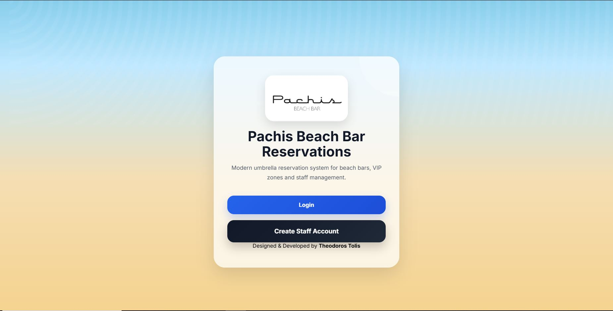
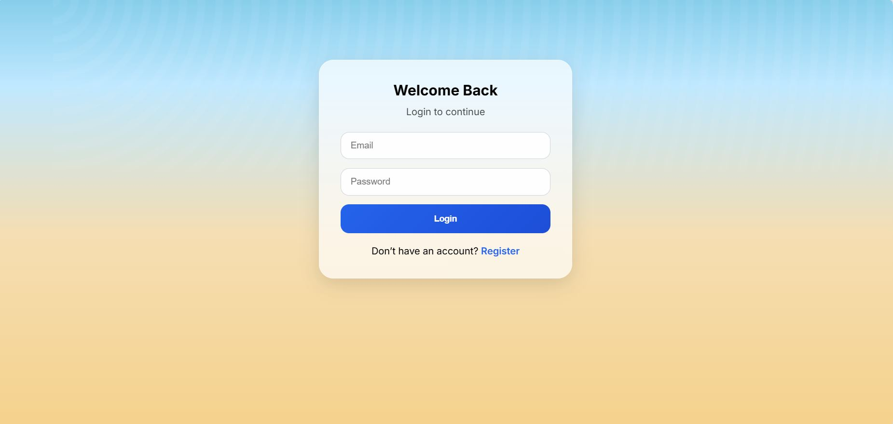
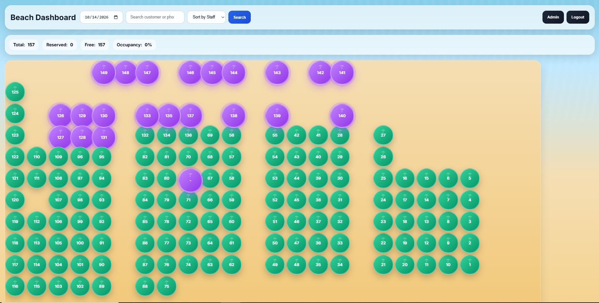

# 🏖️ Pachis Beach Bar Reservation System

A web-based reservation management system developed for **Pachis Beach Bar** to manage beach reservations, organize umbrella locations, and monitor daily availability.

**💼 Developed and sold to a real business.**

The application features an interactive beach layout, reservation management, occupancy statistics, and a centralized dashboard designed to simplify daily beach bar operations.

🌐 **Live Application:** [Pachis Beach Bar Reservations](https://pachisbeachbarreservations.free.nf/index.php?i=2)

---

## 📸 Application Preview

*Interactive dashboard displaying beach spots, reservation availability, and daily occupancy statistics.*

---

## 📌 Project Overview

The Pachis Beach Bar Reservation System was developed to address the practical needs of a real beach bar reservation operation.

The application provides a visual representation of the beach, allowing staff to identify individual umbrella spots and monitor reservation availability for a selected date.

Through a centralized dashboard, staff can view booking statistics, search for reservations, and manage the beach layout.

This project represents a real-world commercial application that I developed and sold to the business where I worked during the summer.

## ✨ Key Features

### 🏖️ Interactive Beach Layout
- Visual representation of individual beach spots.
- Numbered umbrellas for easy identification.
- Color-coded indicators for beach spot status.
- Support for different beach spot types, including VIP areas.
- Interactive positioning of beach spots.

### 📅 Reservation Management
- Manage reservations for specific dates.
- Associate reservations with individual beach spots.
- Search for reservations using customer information.
- Organize and monitor daily bookings.
- Track reservation availability through the dashboard.

### 📊 Reservation Dashboard
- Overview of total beach spots.
- Real-time reservation and availability statistics for the selected date.
- Automatic occupancy percentage calculation.
- Date selection for viewing reservations.
- Customer search functionality.
- Staff-related sorting options.

### 🔐 User Authentication
- User login.
- Staff account registration.
- Session-based authentication.

### 🎨 User Interface
- Beach-themed visual design.
- Interactive dashboard.
- Clear reservation status indicators.
- Centralized reservation management interface.

## 🛠️ Technologies Used

| Technology | Purpose |
|------------|---------|
| PHP | Backend application logic |
| MySQL | Database management |
| HTML5 | Page structure and forms |
| CSS3 | Styling and layout |
| JavaScript | Interactive interface functionality |
| PDO | Database connectivity |
| PHP Sessions | Authentication and session management |

## 🏗️ Application Architecture

The application follows a client-server architecture.

- **Frontend:** HTML, CSS, and JavaScript provide the user interface and interactive dashboard.
- **Backend:** PHP handles application logic, authentication, and reservation operations.
- **Database:** MySQL stores application data, including users, reservations, and beach spots.
- **Session Management:** PHP sessions maintain authenticated user sessions.

## 🖥️ Screenshots

### Login Page

### Beach Reservation Dashboard

### Welcome Page

## 💼 Real-World Application

This project was developed for Pachis Beach Bar, where I worked during the summer, and was subsequently sold to the business.

It demonstrates my ability to translate practical business requirements into a working software solution.

The project provided hands-on experience in developing a web application involving reservation management, database integration, authentication, and interactive user interfaces.

## 🚀 Potential Future Improvements

- Reservation confirmation notifications.
- More detailed booking reports.
- Additional reservation analytics.
- Enhanced user roles and permissions.
- Further improvements to mobile usability.
- Expanded administrative functionality.

## 👨‍💻 Developer

**Theodoros Tolis**

Designed and developed as a commercial web application for beach bar reservation management.
